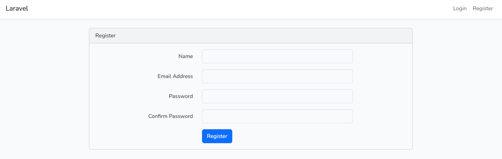
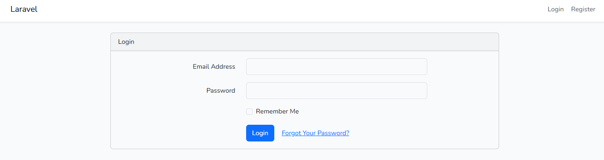
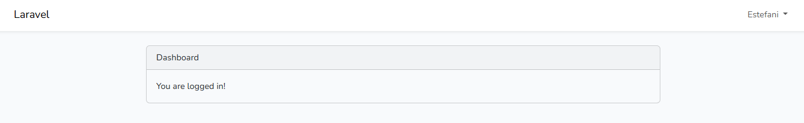
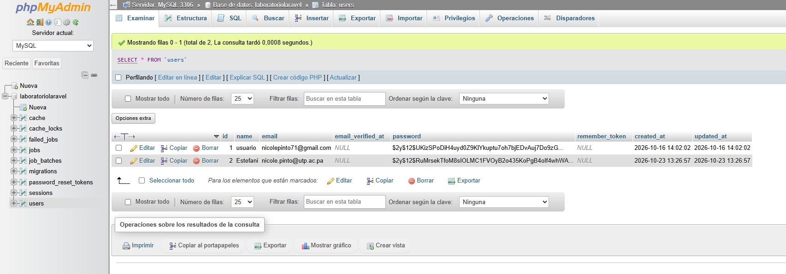

<div align="center">

# 🔐 Laboratorio Laravel: Login y Registro con el patrón MVC

**Universidad Tecnológica de Panamá**
Facultad de Ingeniería de Sistemas Computacionales · Campus Víctor Levis Sasso
**Desarrollo Web** · II Semestre 2026

<p>
  
</p>

</div>

---

## 📑 Tabla de contenido

1. [Introducción y objetivo](#1-introducción-y-objetivo)
2. [Requisitos previos](#2-requisitos-previos)
3. [Instalación y flujo de comandos](#3-instalación-y-flujo-de-comandos)
4. [Arquitectura MVC en el proyecto](#4-arquitectura-mvc-en-el-proyecto)
5. [Base de datos](#5-base-de-datos)
6. [Resultado del laboratorio](#6-resultado-del-laboratorio)
7. [Dificultades y soluciones](#7-dificultades-y-soluciones)
8. [Referencias](#8-referencias)
9. [Fecha de ejecución](#9-fecha-de-ejecución)

---

## 1. Introducción y objetivo

Este laboratorio es un primer acercamiento al framework **Laravel**, su estructura de carpetas y el patrón **Modelo-Vista-Controlador (MVC)**. Como práctica se implementó un módulo de **registro e inicio de sesión de usuarios** conectado a una base de datos **MySQL**.

**Objetivo:** identificar la estructura básica de un proyecto Laravel, comprender cómo se organiza bajo MVC y evidenciar el proceso de configuración e implementación del login.

---

## 2. Requisitos previos

| Tecnología | Versión / detalle |
|---|---|
| 💻 Sistema operativo | Windows |
| 🐘 PHP | 8.3.28 (Laravel 13 requiere PHP 8.2 o superior) |
| 🎼 Composer | Última versión estable |
| 🔴 Laravel | 13.37.0 (creado con Laravel Installer: `laravel new`) |
| 🧩 laravel/ui | 4.6.3 (paquete de autenticación) |
| 🟢 Node.js / npm | npm 11.19.1 (necesario para compilar los estilos con Vite) |
| ⚡ Vite | 8.3.4 |
| 🅱️ Bootstrap | Generado por `laravel/ui` |
| 🧰 Entorno local | WampServer (`C:\wamp64\www`) |
| 🌐 Servidor web | Apache |
| 🐬 Base de datos | MySQL, motor InnoDB (versión: _completar_) |
| 📝 Editor | Visual Studio Code |

---

## 3. Instalación y flujo de comandos

### 3.1 Crear el proyecto

```powershell
cd C:\wamp64\www
laravel new LaboratorioLaravel
cd LaboratorioLaravel
```

Si faltan las dependencias, se instalan con:

```powershell
composer install
```

### 3.2 Configurar el archivo `.env`

```env
DB_CONNECTION=mysql
DB_HOST=127.0.0.1
DB_PORT=3306
DB_DATABASE=laboratoriolaravel
DB_USERNAME=root
DB_PASSWORD=
```

Después de editar el `.env` se limpia la caché de configuración para que Laravel lea los cambios:

```powershell
php artisan config:clear
php artisan config:cache
```

### 3.3 Ajustes para evitar errores en las migraciones

En `app/Providers/AppServiceProvider.php`:

```php
use Illuminate\Support\Facades\Schema;

public function boot(): void
{
    Schema::defaultStringLength(191);
}
```

En `config/database.php`, dentro de la conexión `mysql`:

```php
'engine' => 'InnoDB',
```

### 3.4 Migraciones

```powershell
php artisan migrate
```

### 3.5 Paquete de autenticación (Laravel/UI)

```powershell
composer require laravel/ui
php artisan ui bootstrap --auth
npm install
npm run dev
```

> En Windows PowerShell fue necesario habilitar la ejecución de scripts para que `npm` funcione:
> `Set-ExecutionPolicy -Scope CurrentUser -ExecutionPolicy RemoteSigned`

### 3.6 Levantar el proyecto

```powershell
composer run dev
```

Este comando inicia el servidor (`php artisan serve`), la cola de trabajos y Vite en una sola terminal. El sitio queda disponible en <http://127.0.0.1:8000>.

| Ruta | Función |
|---|---|
| `/register` | Formulario de registro |
| `/login` | Formulario de inicio de sesión |
| `/home` | Página a la que se llega después de autenticarse |

---

## 4. Arquitectura MVC en el proyecto

| Capa | Carpeta / archivo | Función |
|---|---|---|
| **Modelo** | `app/Models/User.php` | Representa la tabla `users` y se comunica con la base de datos. |
| **Vista** | `resources/views/` (`auth/login.blade.php`, `auth/register.blade.php`, `layouts/app.blade.php`) | Lo que ve el usuario: formularios y páginas en Blade. |
| **Controlador** | `app/Http/Controllers/` (`Auth/LoginController.php`, `Auth/RegisterController.php`, `HomeController.php`) | Recibe las peticiones, valida datos y decide qué vista mostrar. |
| **Rutas** | `routes/web.php` | Conecta cada URL con su controlador (`Auth::routes()` registra login, registro, etc.). |
| **Migraciones** | `database/migrations/` | Describen la estructura de las tablas de la base de datos. |

**Flujo de una petición:** el navegador pide `/register` → `routes/web.php` la dirige al controlador → el controlador usa el modelo `User` para guardar en MySQL → devuelve una vista Blade al usuario.

---

## 5. Base de datos

- **Motor:** MySQL (WampServer), base de datos `laboratoriolaravel`.
- **Conexión:** definida en el archivo `.env` (host, puerto, nombre de la base de datos, usuario y contraseña). El archivo `.env` **no se sube al repositorio**; se incluye `.env.example` como plantilla.
- **Migraciones:** las tablas se crean desde `database/migrations/` con `php artisan migrate`.

Tablas creadas: `users`, `password_reset_tokens`, `sessions`, `cache`, `cache_locks`, `jobs`, `job_batches`, `failed_jobs` y `migrations`.

Comandos útiles utilizados:

```powershell
php artisan migrate          # crea las tablas pendientes
php artisan migrate:status   # muestra qué migraciones se ejecutaron
php artisan migrate:fresh    # borra todo y vuelve a crear las tablas
```

### 💾 Respaldo (backup)

El respaldo de la base de datos está en [`database/backup/laboratoriolaravel.sql`](database/backup/laboratoriolaravel.sql). Se generó con:

```powershell
mysqldump -u root --result-file=database\backup\laboratoriolaravel.sql laboratoriolaravel
```

---

## 6. Resultado del laboratorio

Pantalla de registro funcionando:



Pantalla de inicio de sesión:



Pantalla de iusuario loggeado:



Usuario registrado en la tabla `users`:



---

## 7. Dificultades y soluciones

**Dificultad 1: versión de PHP incompatible.**
`composer install` fallaba porque la terminal usaba PHP 8.0.30 y Laravel 13 necesita 8.2 o superior. Composer buscó una versión vieja de Laravel con alertas de seguridad y nunca se creó la carpeta `vendor/`.
**Solución:** se activó PHP 8.3.28 de WampServer y se actualizó el `Path` de Windows para que apuntara a `C:\wamp64\bin\php\php8.3.28`. Se verificó con `php -v` y se creó el proyecto de nuevo.

**Dificultad 2: comando de borrado y proyecto existente.**
`rmdir /s /q` no funciona en PowerShell y `laravel new` respondía `Application already exists!`.
**Solución:** se usó `Remove-Item -Recurse -Force LaboratorioLaravel` y luego se creó el proyecto otra vez.

**Dificultad 3: `npm` bloqueado en PowerShell.**
Windows tenía deshabilitada la ejecución de scripts.
**Solución:** `Set-ExecutionPolicy -Scope CurrentUser -ExecutionPolicy RemoteSigned`.

**Dificultad 4: la base de datos por defecto era SQLite, no MySQL.**
El instalador configuró `DB_CONNECTION=sqlite`, por eso `php artisan migrate` decía "Nothing to migrate".
**Solución:** se editó el `.env` para usar MySQL, se limpió la caché con `php artisan config:clear` y se volvió a migrar.

**Dificultad 5: error `Specified key was too long` y tablas a medias.**
La migración de `users` falló por la longitud de la llave y quedó la tabla creada a medias. Después aparecía `Table 'users' already exists` y la página mostraba `Table 'sessions' doesn't exist`.
**Solución:** se agregó `Schema::defaultStringLength(191)` en `AppServiceProvider`, se configuró el motor `InnoDB` y se ejecutó `php artisan migrate:fresh`.

**Dificultad 6: `composer run dev` se reiniciaba al editar el `.env`.**
Vite y el servidor se reinician cada vez que cambia el `.env`.
**Solución:** terminar de editar y guardar el `.env` antes de levantar el proyecto con `composer run dev`.

---

## 8. Referencias

1. Laravel. *Documentación oficial*. <https://laravel.com/docs>
2. Laravel. *laravel/ui: paquete de scaffolding de autenticación*. <https://github.com/laravel/ui>
3. Composer. *Documentación*. <https://getcomposer.org/doc/>
4. Fong, I. *Guía de Laboratorio: Cómo crear un Login y Registro en Laravel*. Universidad Tecnológica de Panamá, 2026.

---

## 9. Fecha de ejecución

Laboratorio realizado los días **15 y 16 de octubre de 2026**.

---

<div align="center">

Este laboratorio ha sido desarrollado por el estudiante de la **Universidad Tecnológica de Panamá**:

**Nombre:** Nicole Pinto
**Correo:** nicole.pinto@utp.ac.pa
**Curso:** Desarrollo Web
**Instructor del Laboratorio:** Irina Fong

</div>
